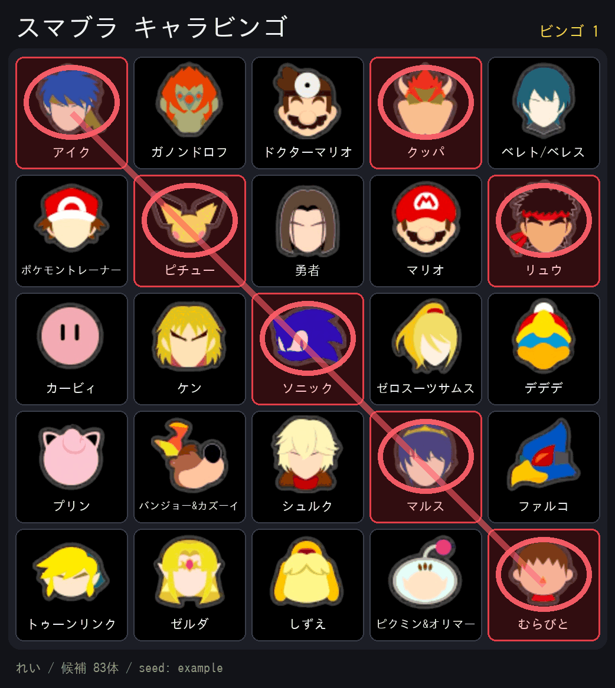

# スマブラ キャラビンゴ LINE ボット

トークで「ビンゴ」と送ると、スマブラSPのファイターをランダムに並べた
ビンゴカードの画像を返す LINE ボットです。



- 全86ファイターから重複なしで 5×5 を抽選（FREEマスなし・Miiファイターは除外）
- 画像はキャラアイコン付き
- グループトークでも1対1でも動きます

## 使い方

トークに **「ビンゴ」** と送るだけです（「ビンゴやろう」のように含まれていればOK）。
2チームぶん欲しいときは2回送ってください。毎回ちがうカードが出ます。

## 仕組み

カードはシード文字列から毎回まったく同じものを組み立て直せるので、
**画像を保存しておく必要がありません**。

1. 「ビンゴ」を受け取ったら、ランダムなシードを作る
2. `https://<サーバー>/c/<シード>.png` という画像メッセージを返す
3. LINEがその画像を取りに来たタイミングで、その場で描いて返す

状態を持たないので、サーバーレス（Cloud Run など）にそのまま載ります。

## 1. LINE側の準備

1. [LINE Developers](https://developers.line.biz/console/) にログイン
2. プロバイダーを作る（無ければ）→ **Messaging API** チャネルを作成
3. **「Messaging API設定」** タブ
   - **チャネルアクセストークン（長期）** を発行してコピー → `LINE_CHANNEL_ACCESS_TOKEN`
   - **応答メッセージ** を「オフ」、**あいさつメッセージ** は好みで
   - **Webhook の利用** を「オン」
4. **「チャネル基本設定」** タブの **Channel secret** をコピー → `LINE_CHANNEL_SECRET`
5. グループで使う場合は「Messaging API設定」の
   **グループ・複数人チャットへの参加を許可する** をオンにする

Webhook URL は、サーバーを動かしてから（手順2のあと）
`https://<サーバーのURL>/callback` を設定します。

## 2. 動かす

### Cloud Run（おすすめ・無料枠で収まる）

HTTPSのURLが自動でもらえるので、ドメインも証明書も要りません。

```bash
gcloud run deploy smash-bingo \
  --source . \
  --region asia-northeast1 \
  --allow-unauthenticated \
  --set-env-vars "LINE_CHANNEL_SECRET=xxxx,LINE_CHANNEL_ACCESS_TOKEN=yyyy"
```

表示された `https://smash-bingo-....run.app` の末尾に `/callback` を付けたものを、
LINE Developers の Webhook URL に設定して「検証」を押します。

> しばらく誰も使わないとインスタンスが落ちるため、久しぶりの1回目だけ
> 反応が数秒遅れることがあります。気になる場合は
> [cron-job.org](https://cron-job.org) などから `/healthz` を10分おきに
> 叩いておくと、無料枠のまま常に温まった状態を保てます。

### VPS（Docker）

```bash
cp .env.example .env     # トークンとシークレットを書く
docker compose up -d --build
```

`127.0.0.1:8080` で待ち受けます。LINEはHTTPSでしか画像を取りに来ないので、
**前段に Caddy や Nginx を置いてHTTPS化**し、ドメインを当ててください。
Caddy なら `Caddyfile` はこれだけです。

```
bingo.example.com {
    reverse_proxy 127.0.0.1:8080
}
```

### 手元で試す

```bash
python3 -m venv .venv
.venv/bin/pip install -r requirements.txt
set -a && . ./.env && set +a
.venv/bin/python -m linebingo
```

`http://127.0.0.1:8080/c/test123.png` を開くとカード画像が見られます。
LINEと繋ぐには ngrok などで外から見えるようにしてください。

## 環境変数

| 名前 | 必須 | 内容 |
| --- | --- | --- |
| `LINE_CHANNEL_ACCESS_TOKEN` | ○ | チャネルアクセストークン（長期） |
| `LINE_CHANNEL_SECRET` | ○ | チャネルシークレット（署名の検証に使う） |
| `BASE_URL` | | 画像URLの組み立てを固定したいときだけ。ふだんはリクエストから自動判定 |
| `BINGO_SIZE` | | 1辺のマス数（既定 5） |
| `BINGO_FONT` | | 日本語フォントのパス（既定ではOSの標準フォントを探す） |
| `PORT` | | 待ち受けポート（既定 8080。Cloud Runが自動で設定します） |

## キャラアイコンについて

`assets/icons/` のアイコンは、元のアイコンシート（`assets/_src/`）から
`scripts/extract_icons.py` で切り出したものです。シートを差し替えたときは:

```bash
python3 scripts/extract_icons.py
```

シートは2枚あります。`sheet.jpg`（7列×16行）が本体で、カズヤとソラだけは
これに入っていないため `sheet2.jpg`（8列×15行）の最終行から取っています。
どちらもカラーバリエーション（ナナ、ポケモン、コクッパ、勇者の別主人公など）が
1枠ずつ入っているので、代表の1枚だけを各ファイターに割り当てています。

## カードの画像だけ試す

LINEを使わずに画像の出来を確認できます。

```bash
.venv/bin/python scripts/preview.py preview.png 5
```

## Discord版も入っています

同じカードを Discord でも使えます。そちらはボタンでマスをマークでき、
ビンゴになると知らせます。

```bash
DISCORD_TOKEN=... .venv/bin/python -m smashbingo
```

詳しくは `smashbingo/bot.py` を見てください。Dockerで動かす場合は
`Dockerfile` の `CMD` を `["python", "-m", "smashbingo"]` に変えます。
LINEだけ使うなら `smashbingo/bot.py` `smashbingo/storage.py` と
requirements.txt の `discord.py` は消してしまって構いません。

## ファイル

| パス | 役割 |
| --- | --- |
| `linebingo/main.py` | LINEのWebhookと画像を返すサーバー |
| `linebingo/line_api.py` | 署名の検証とメッセージ送信 |
| `smashbingo/fighters.py` | 全86ファイターのデータとアイコンの対応 |
| `smashbingo/bingo.py` | カードの抽選・マーク・ビンゴ判定 |
| `smashbingo/render.py` | カード画像の描画 |
| `smashbingo/bot.py` | Discord版のボット |
| `Dockerfile` / `docker-compose.yml` | コンテナ設定 |
| `scripts/extract_icons.py` | アイコンシートの切り出し |
| `scripts/preview.py` | 画像の試し描き |
